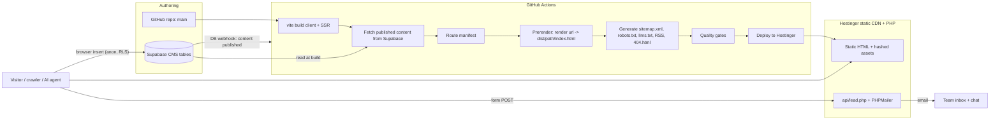
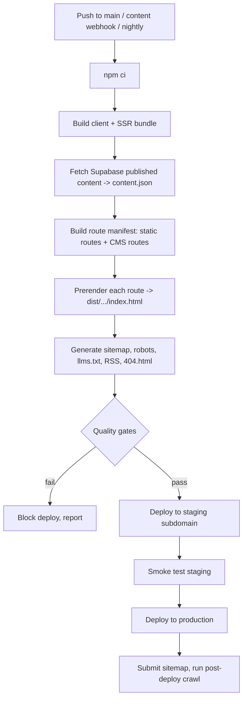

# Qala Labs Website: Target System Architecture

Prepared 2026-11-19. Scope: the public website at https://qalalabs.com (`Website/New folder`, branch `main`). Inputs: the live-site crawl of all 56 sitemap URLs, `SEO_IMPLEMENTATION_PLAN.md`, the content audit, `UIUX_PAGE_BY_PAGE_IMPROVEMENTS.md`, and a read of the repo (`vite.config.ts`, `entry-server.tsx`, `main.tsx`, `server.js`, `public/.htaccess`, `public/api/lead.php`, `.github/workflows/ci.yml`, Supabase migrations).

**Decision in one line:** keep the stack (React + Vite + Supabase + Hostinger) and change how it is built and shipped: **prerender every public page at build time, deploy the static output from CI, keep PHP for the lead endpoint, and drive sitemap, canonicals, schema, `llms.txt` and `robots.txt` from one route manifest.**

**Confirmed by the owner on 2026-11-25:** (1) the final design is **light only**, so the dark/light toggle and `forcedTheme="dark"` are removed and the `AGENTS.md` dark-background rules need rewriting for a light palette; (2) **GitHub Actions can deploy to Hostinger**, so the CI deploy step in this plan is approved (the exact mechanism, such as SFTP, SSH or Git deploy, is still to be chosen).

---

## 1. What exists today, and what is wrong with it

| Area | Today (evidence) | Problem |
|---|---|---|
| Rendering | React SPA. `main.tsx` already hydrates when the root has content. `entry-server.tsx` exports `render(url)` returning `{ html, helmet }`. | Production serves an empty shell for every URL (raw HTML has no H1, no body, one shared title). An earlier audit on 2026-09-16 found the same; it persists. |
| Hosting | Hostinger static (`Server: hcdn`) with `.htaccess` fallback to `index.html`. | `server.js` (Express SSR plus API) is not run there, so the SSR code is dead in production. Unknown URLs return 200. |
| Deploy | `.github/workflows/ci.yml` runs `npm ci` and `npm run build` only. | CI never deploys. The live site is a manually uploaded build, and it is stale: source forces a dark theme (`forcedTheme="dark"`), the live site shows a light theme with a toggle, and live pages lack the JSON-LD that `ServiceDetail.tsx` emits. |
| Build | `npm run build` produces the client bundle and an SSR bundle (`dist/server`). No prerender step. | Nothing turns the SSR bundle into HTML files. |
| CMS | Supabase tables (`pages`, `blog_posts`, `case_studies`, `services`, `portfolio_projects`, `media_library`, `site_settings`). Pages fetch at runtime in the browser. | Content arrives after JS runs, so it is invisible to non-JS crawlers. `site_settings` has no `global_config` row (406). |
| Lead capture | Two implementations: `public/api/lead.php` (PHP, PHPMailer, reads SMTP config from env or an out-of-webroot config) and `server.js` `/api/lead`. Forms also insert into Supabase `leads` from the browser. | Two code paths to maintain. `server.js` is the file with the SMTP fallback-password incident noted in project memory. |
| Routing and SEO data | Routes in `App.tsx`; `public/sitemap.xml` hand-maintained; `llms.txt` hand-written; per-page meta via `<SEO>`/Helmet. | Sitemap, canonicals and `llms.txt` drift from real routes. `index.html` also hard-codes title, description and canonical. |
| Static folders vs routes | `public/case-studies/` and `public/portfolio/` hold images. | They collide with the SPA routes `/case-studies/` and `/portfolio/`, which return 403 from the server. |
| Code shape | The skill's analyzer found `server.js` at 642 lines, `entry-server.tsx` with 92 imports, and 5 page files over 500 lines (`GaffarIndiaPortfolio.tsx` is 1,123). 67 direct dependencies; coupling score 0/100 (low, good). The "unstructured" pattern result is the tool not recognising a `pages/components` React layout, so ignore it. | Large page files mix content and layout; content that belongs in the CMS is hard-coded in components. |

---

## 2. Target architecture



**Principles**
1. **Static first.** Every public URL is an HTML file with real content, a unique title, canonical, JSON-LD, one H1 and an internal-link graph. The SPA hydrates on top.
2. **One source of truth for routes and SEO data.** A route manifest feeds the prerenderer, sitemap, canonicals, breadcrumbs, `llms.txt` and tests. Nothing is listed by hand twice.
3. **CMS for content, code for layout.** Copy that changes (services, agents, case studies, posts, city pages) lives in Supabase and is rendered through a small set of templates.
4. **Fail closed in CI.** A deploy that breaks canonicals, sitemap, 404s, headers or budgets does not ship.
5. **Keep the cheap, boring hosting** until a measured need says otherwise.

---

## 3. Decisions (ADRs)

| ADR | Decision | Why | Trade-off accepted | Revisit when |
|---|---|---|---|---|
| 1. Rendering | **Build-time prerender (SSG)** of all public routes using the existing `render(url)` | Fixes the empty-shell problem on the current host with the least change. Static files are fast and cheap. | Content changes need a rebuild (a few minutes). Per-user content can't be prerendered (none is needed on public pages). | Page count passes a few hundred and builds exceed about 10 minutes, or you need per-request personalization. |
| 2. Hosting | **Stay on Hostinger** (static plus PHP). Do not run `server.js` in production. | Already paid for and fast (CDN). SSG removes the need for a Node runtime. | Fewer deploy conveniences than Vercel or Cloudflare Pages. | You need edge logic, previews per PR, or Hostinger blocks automated deploys. Cloudflare Pages is the first alternative; `vercel.json` already exists. |
| 3. Lead API | **`public/api/lead.php` is the single production endpoint.** Retire `/api/lead` from `server.js` for production use. | One code path on the host that actually runs. Credentials already come from env or an out-of-webroot config. | PHP, not Node; the team maintains one small PHP file. | You move off Hostinger. |
| 4. Content source | **Supabase read at build time** with anon key and RLS select policies on published rows. A Supabase webhook triggers a rebuild when content is published. | Keeps the existing admin workflow; crawlers see content in HTML. | Publish-to-live delay of one build. Needs working RLS policies (several tables currently have RLS on with no policy). | You want instant publish; add on-demand revalidation via a host with an API. |
| 5. SEO data | **One `seo` module** builds title, meta, canonical, OG, JSON-LD and breadcrumbs from the manifest plus CMS fields. Remove hard-coded meta from `index.html`. | Ends the "homepage canonical on 49 pages" class of bug. | Refactor of `<SEO>` and page components. | Never; this is foundational. |
| 6. Images | **`vite-imagetools` pipeline (already installed)** through one `<Image>` component: WebP/AVIF, `srcset`, `width`/`height`, lazy by default. | Fixes 616 images without size attributes and the legacy PNG/JPG weight. | Authors must use the component. | n/a |
| 7. Motion | **A motion policy provider.** One reduced-motion switch, one duration/easing token set, Three.js paused off-screen. | No reduced-motion handling found; 49 animating elements on the homepage. | Slightly less flashy by default. | n/a |
| 8. Analytics | **GA4, Meta Pixel and Clarity loaded through one tag layer** with the `RouteTracker` from `AGENTS.md`, async, after first paint. | The site currently has no tracking tags. | Adds third-party weight; measure it. | n/a |
| 9. Repos | **`main` = public website only.** The `master` branch (admin panel, CRM, Express, migrations) becomes a separate private repo. | Two repos share one remote today; the public repo already leaked a secret once. | One-time repo reshuffle. | n/a |

---

## 4. Build and delivery pipeline



**New files (proposed)**
- `scripts/build-manifest.ts`: static routes plus CMS routes into `dist/routes.json`.
- `scripts/prerender.ts`: calls `render(url)`, injects `helmet` tags and `<div id="root">` markup, writes `dist/<route>/index.html`, plus `404.html`.
- `scripts/generate-seo-files.ts`: `sitemap.xml` (only 200, indexable, self-canonical URLs, real `lastmod`), `robots.txt`, `llms.txt`, RSS for the blog.
- `scripts/verify.ts`: the quality gates below.
- `src/seo/` : `buildMeta`, `schema.ts` (Organization, WebSite, Service, Article, FAQPage, BreadcrumbList, LocalBusiness only for real offices).

**Quality gates (all must pass)**
| Gate | Check |
|---|---|
| Crawl | Every manifest URL returns 200, has exactly one H1, a unique title, a unique meta description, and canonical equal to its own URL. |
| Sitemap | Every sitemap URL is in the manifest; no sitemap URL redirects, 403s or 404s. |
| Schema | JSON-LD parses and passes a validator for each page type. |
| 404 | An unknown path serves `404.html` with status 404 and `noindex`. |
| Headers | HSTS, `nosniff`, referrer policy, `X-Frame-Options`, correct `Content-Type` for `llms.txt` and `sitemap.xml`. |
| Performance budgets | Lighthouse CI on 8 template pages: LCP at most 2.5s, CLS at most 0.1, TBT in range, JS and image budgets (no asset over the 500KB rule in `AGENTS.md`). |
| Accessibility | axe (run locally in CI, not from a CDN inside live pages): zero serious or critical violations on the 8 templates. |
| Links and images | No broken internal links or images; every image has alt (empty only if decorative). |
| Secrets | A secret scan on the repo diff (the SMTP fallback incident must never recur). |

**Prerender hazards to design for**
- Components touching `window`, `document`, `canvas` or Three.js render nothing on the server and mount after hydration (lazy import, `useEffect`).
- Randomized or time-based text (for example the rotating hero H1) must render a fixed value on the server and on first client render, or hydration will mismatch.
- `entry-server.tsx` imports about 90 modules eagerly; that is fine at build time, but generate the page map from the manifest instead of hand-listing imports.
- Serialize the fetched CMS data into the HTML (`window.__DATA__`) and feed it to React Query on the client so hydration does not refetch or flash.

---

## 5. Runtime architecture on the host

**Static layer** (Hostinger CDN)
- `dist/` uploaded as-is. Hashed assets cached for one year; HTML revalidated.
- `.htaccess` rewritten to: force HTTPS and non-www (retest, since `www` returned 200); serve `404.html` with a real 404; **no blanket fallback to `index.html`**; map `/api/lead` to `api/lead.php`; keep the deny rules for dotfiles and config; keep security headers.
- Move the image folders that collide with routes (`public/case-studies/` and `public/portfolio/`) to `public/img/...` so `/case-studies/` and `/portfolio/` resolve to prerendered pages.

**PHP layer** (`api/lead.php`)
- Validate and sanitize; honeypot field plus simple rate limit; return JSON with `success` and an HTTP status that forms check (`response.ok`).
- Send the team notification and the customer confirmation through PHPMailer using credentials from host environment variables or a config file outside the webroot.
- Browser forms keep their direct, RLS-guarded insert into `leads`; the PHP endpoint only sends mail. `AGENTS.md` rules remain: never show success unless the response is ok, show an inline fallback (mailto or WhatsApp) on failure.

**Supabase** (managed)
- Tables: existing CMS tables plus the fixes below. Used at build time (read) and by the browser (`leads` insert, admin CMS).
- Required fixes before relying on build-time reads: RLS select policies on published rows for every CMS table (`blog_posts`, `media_library`, `portfolio_projects`, `site_settings` currently have RLS on and no policy); insert the missing `site_settings.global_config` row; apply the advisor fixes already logged in project notes (locked-down `SECURITY DEFINER` functions, FK indexes, `(select auth.uid())` wrapping, leaked-password protection).

---

## 6. Front-end application architecture

```
src/
  app/            router, providers (Query, Helmet, Theme, Motion, Auth), RouteTracker, ScrollToTop
  seo/            buildMeta, schema builders, route manifest types
  templates/      HubTemplate, ServiceTemplate, AgentTemplate, ProductTemplate,
                  CaseStudyTemplate, ArticleTemplate, CityTemplate, LegalTemplate
  components/
    ui/           shadcn/Radix primitives (existing)
    media/        Image, Video (poster, lazy, no autoplay audio), Diagram (inline SVG)
    forms/        LeadForm (labels, validation, dual-endpoint, tracking), FormStatus
    layout/       Header, Footer, Breadcrumbs, SkipLink, TableOfContents, FAQ, RelatedLinks
    floating/     FloatingActions (single manager for sticky CTA + chat; honors bottom-24 sm:bottom-6)
    motion/       MotionProvider, Reveal, CountUp (all respect reduced motion)
  pages/          thin route wrappers; no hard-coded long-form copy
  content/        static fallback content, route manifest source
```

**Templates map to the sitemap** (so the content audit's gaps are fillable without new code):
| Template | Pages |
|---|---|
| HubTemplate | `/services`, `/blog`, `/case-studies` (merged proof hub), `/products` |
| ServiceTemplate | `/services/*`, plus new `mcp-server-development`, `ai-agent-development`, `ai-marketing`, `n8n-automation`, `whatsapp-ai-chatbot` |
| AgentTemplate | `/agents/*` (workflow diagram, integrations, FAQ, link to pillar) |
| ProductTemplate | `/products/*` |
| CaseStudyTemplate | `/case-studies/*` (metrics above the fold, quote, stack, related) |
| ArticleTemplate | `/blog/*` (TOC, takeaways, related posts, dates) |
| CityTemplate | `/marketing-agency-delhi`, `-gurgaon`, `-noida`, `/ai-automation-agency-gurugram` (local proof, real address or service area, local case study, FAQ) |
| LegalTemplate | `/privacy`, `/terms` |

**Content model changes (Supabase)**
- Add or confirm per-row fields: `slug`, `template`, `seo_title`, `seo_description`, `canonical_override`, `og_image`, `noindex`, `published_at`, `updated_at`, `faq` (JSON), `related` (slugs), `schema_type`.
- Case studies: `client_name`, `anonymized`, `metrics` (JSON with value, label, source, period), `testimonial`, `stack`.
- Metrics carry `source` and `period` so the "28X / 71% / 4.2Cr" claims are traceable.
- Long hard-coded pages (for example `GaffarIndiaPortfolio.tsx`, 1,123 lines) are migrated into CMS rows over time.

**Cross-cutting UI rules** (from the UI/UX audit)
- `<Image>` requires dimensions; lazy by default; hero is the one eager image.
- Headings: one H1; no skipped levels (a lint rule or test).
- Tap targets at least 44px; body text 16px; minimum 12px for labels.
- Skip link, visible focus ring, labelled form fields, `aria-live` for form status.
- One floating action at a time on mobile.
- Reduced-motion respected globally; one hero animation; others one-shot.

---

## 7. Security architecture

| Risk | Control |
|---|---|
| Leaked SMTP credential in a public repo's history (open item in project notes) | Rotate the Hostinger mailbox password **first**. Remove any fallback value from code. Scan history and consider `git filter-repo` plus force-push only after rotation. Keep secrets only in host environment or an out-of-webroot config. |
| Secrets committed again | CI secret scan; `.gitignore` covers `admin/config.env` and `.env*`; the private ops repo (ADR 9) keeps admin config out of the public repo. |
| Lead endpoint abuse | Honeypot, rate limit, server-side validation, CORS limited to the site origin, no stack traces in responses. |
| Supabase misuse | RLS on every table with explicit policies; anon can only select published rows and insert into `leads`; fix the `SECURITY DEFINER` and shadow `users.password_hash` findings; enable leaked-password protection. |
| Internal routes indexed or exposed | `/admin`, `/dashboard`, `/employee`, `/client`, `/login`, `/onboarding`, `/demo/*` get `noindex`, are disallowed in robots, and the demo routes are removed from production builds. |
| Headers | HSTS, `nosniff`, `Referrer-Policy`, `Permissions-Policy`, framing policy; consider a report-only CSP first, since third-party tags will need allowances. |
| Third-party scripts | Loaded through one tag layer, async, with a documented allowlist. |
| Privacy | Cookie and consent handling for analytics and pixels and a privacy-policy update are required. Confirm the legal requirements with counsel. |

---

## 8. Observability and operations

- **Search:** Google Search Console and Bing Webmaster Tools verified; weekly review of indexing, coverage and performance during rollout, monthly afterward.
- **Experience:** GA4 (with `RouteTracker` virtual page views), Microsoft Clarity, Core Web Vitals field data from Search Console or CrUX.
- **Synthetic:** nightly crawl of the manifest (reuse `verify.ts`) plus a post-deploy run; alert on any non-200, wrong canonical, or missing H1.
- **Uptime:** an external check on `/`, `/api/lead` (HEAD or health route), and `sitemap.xml`.
- **Leads:** an alert if no lead has arrived in N days while traffic is normal, since the dual endpoint can fail silently.
- **AI visibility:** monthly manual prompt log (ChatGPT, Perplexity, Google AI Overviews).

**Targets (to confirm against the Phase 0 baseline)**
| Measure | Target |
|---|---|
| Indexed pages vs manifest | 100% of indexable pages |
| LCP / INP / CLS (mobile, 75th percentile) | at most 2.5s / 200ms / 0.1 |
| Unique title and canonical per URL | 100% |
| Build to live time | under 10 minutes |
| Lead delivery success | at least 99% (form success always matches a real 2xx) |

---

## 9. Migration plan (maps to the earlier plans)

| Step | Work | Depends on | Risk |
|---|---|---|---|
| 0 | Rotate the SMTP password; verify Search Console; capture baselines; decide repo split | none | Low |
| 1 | **Redeploy from current source** and diff against live (confirms the stale-build finding; may fix titles/JSON-LD on its own) | 0 | Low |
| 2 | Fix `.htaccess`: 404 handling, www redirect, directory collisions; move image folders; serve `llms.txt` as text; fix sitemap/route mismatches | 1 | Medium (a bad rule can break the site; use staging) |
| 3 | Build the route manifest, `<SEO>` single source, remove hard-coded meta from `index.html` | 1 | Medium |
| 4 | Prerender step and `verify.ts` gates; deploy to a staging subdomain first | 3 | Medium-high (hydration mismatches) |
| 5 | CI deploy to production (staging then prod), webhook-triggered rebuilds | 4 | Medium |
| 6 | Shared `<Image>`, `LeadForm`, `FloatingActions`, `MotionProvider`, skip link, heading lint | 3 | Low |
| 7 | New templates and content (MCP, AI agents, city pages) in the CMS | 4 | Low |
| 8 | Supabase RLS and advisor fixes; seed `global_config`; remove demo routes from prod | 0 | Medium |
| 9 | Retire production use of `server.js` lead and SSR routes; keep it for local dev if useful | 5 | Low |

Steps 1 and 2 are the fastest wins. Step 4 is the largest change.

---

## 10. Risks and assumptions

- **Confirmed by the owner:** GitHub can deploy to Hostinger. Still to decide: the mechanism (SFTP, SSH/rsync or Git deploy) and where its credentials live (GitHub Actions secrets, never in the repo).
- **Assumed, not verified:** that the anon key can read published rows at build time. Several tables have RLS on with no select policy, so this must be fixed first.
- **Prerender complexity:** the Three.js and canvas sections and the rotating hero may cause hydration mismatches; budget time for this.
- **Stale deploy:** the live build differs from the source in at least two visible ways (theme and JSON-LD). Treat all earlier live-site measurements as measurements of the old build until step 1 is done.
- **Contrast and Core Web Vitals** were not measured reliably (see the UI/UX document); the gates in section 4 close that gap.
- **Claims and content:** the numbers shown on pages (28X ROAS and others) are unverified by me; the `metrics.source` field exists to make them traceable.
- **Tooling note:** one command in this session was blocked by a privacy hook because `server.js` contains contact addresses. I did not read the SSR meta-injection block of `server.js`, so its current behavior is inferred from the grep output (it injects meta from Supabase into the HTML template).

## 11. Open questions
1. ~~Can GitHub Actions deploy to Hostinger?~~ Yes (confirmed). Which mechanism: SFTP, SSH/rsync or Git deploy?
2. Who owns content publishing, and is a rebuild delay of a few minutes acceptable?
3. Is the repo split (public `main`, private ops `master`) approved?
4. Which cities have a real, staffed office (affects LocalBusiness schema and any Google Business Profile)?
5. ~~Is dark-only the final design?~~ Final design is **light only** (confirmed). Open: the light palette and background tokens that replace `#06070D` and the ambient mesh rules in `AGENTS.md`.
